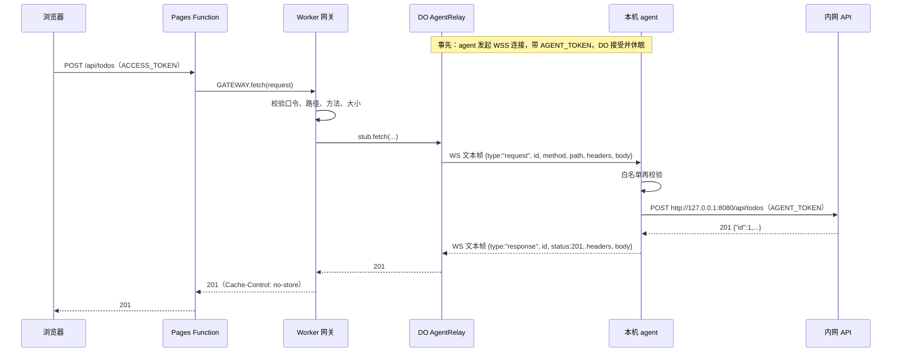

# Relay Todo Demo 设计文档

> 状态：已实现并部署验证（2026-10-23）。
> 一句话：页面放在 `pages.dev`，待办数据留在本机（内网）。本机的 **agent** 通过 **WSS 443 主动连到 Cloudflare 的 Durable Object（DO）**，浏览器的增删改查请求经这条长连接转发到本机 API。

---

## 1. 背景与目标

### 1.1 背景

上一个方案（`vpc-todo-demo`）用的是 Workers VPC + Cloudflare Tunnel，在公司网络里走不通：

| 问题 | 原因 |
|---|---|
| 浏览器打不开 `*.workers.dev` | 公司 DNS 不解析 `workers.dev` |
| Worker 经 VPC 访问内网返回 500 | Workers VPC 要求 Tunnel 用 QUIC，也就是 **UDP 7844**，而公司网络只放行 TCP |

公司网络能做到的是：解析并访问 `pages.dev`，并且可以发起**出站 HTTPS/WSS 443** 连接。本方案只依赖这两点。

### 1.2 目标

- 跑通这条链路：浏览器 → `pages.dev` → Pages Function → Worker 网关 → DO 中继 ⇄（WSS 443）⇄ 本机 agent → 本机 API → SQLite。
- 用待办事项演示完整的增删改查。
- 全部使用 Cloudflare 免费额度，不需要自己的域名，不运维公网服务器。
- 本机**不开放任何入站端口**，也不需要 `cloudflared`。
- 提供脚本工具，按 README 操作就能部署和验证。

### 1.3 非目标

- 多用户、按用户隔离数据（所有人共享一份列表）。
- 生产级高可用：本机休眠或断网时 API 不可用。
- 多个 agent 负载均衡（同一时间只认最新连上的一个 agent）。
- 分页、搜索、冲突检测、离线支持、CI/CD。
- 公司网络有强制 HTTPS 代理时的兼容（agent 直连，不走 `HTTPS_PROXY`）。

---

## 2. 已确认决策

| # | 主题 | 决策 |
|---|---|---|
| 1 | 业务数据 | 待办事项：标题、是否完成、创建时间、更新时间 |
| 2 | 连通方式 | 本机 agent **主动出站** WSS 443，连到 Cloudflare Durable Object；不用 VPC、Tunnel 或 `cloudflared` |
| 3 | 公网入口 | `pages.dev`（Pages 项目 `relay-todo-demo`）。Worker 设 `workers_dev = false`，只能经 Pages 的 Service 绑定访问 |
| 4 | 中继 | 一个 SQLite 型 DO 类 `AgentRelay`，固定实例名 `default`，使用 WebSocket **Hibernation API**；空闲时不计时长费用 |
| 5 | 内网 API | Node.js 内置 `http` + `node:sqlite`，零依赖，只监听 `127.0.0.1` |
| 6 | agent | Node.js 内置 `WebSocket`，零依赖；带心跳和指数退避重连 |
| 7 | 口令 | 两把，可以是任意非空字符串：`ACCESS_TOKEN`（用户访问口令）、`AGENT_TOKEN`（agent 口令） |
| 8 | 校验分工 | Worker 网关：用户口令、路由白名单、16 KB 上限；agent：再按白名单校验一次；内网 API：业务校验 |
| 9 | 前端 | 原生 HTML + JS，无构建；口令存 `localStorage`，点击“退出”清除 |
| 10 | 并发修改 | 以最后一次写入为准 |
| 11 | 运行环境 | 本人 macOS 电脑，`npm start` 前台运行内网 API + agent |
| 12 | 部署 | `npm run deploy` 一条命令部署 Worker、上传 secret、创建并部署 Pages |
| 13 | 本地联调 | `wrangler dev` 在本机运行 Worker 和 DO（不需要登录 Cloudflare），agent 连 `ws://127.0.0.1:8787` |
| 14 | 命名 | 目录 `relay-todo-demo/`；Pages 项目 `relay-todo-demo`；Worker `relay-todo-demo-gateway` |

---

## 3. 总体架构

### 3.1 组件与链路

```text
┌────────────────────────────── Cloudflare（公网）──────────────────────────────┐
│                                                                                │
│  浏览器 ──https──► relay-todo-demo.pages.dev（Pages）                          │
│                     ├─ /、/app.js …  ──► 静态资源（免费，不执行 Functions）     │
│                     ├─ /api/*        ──► Pages Function ─┐                     │
│                     └─ /agent/connect ─► Pages Function ─┤ Service 绑定 GATEWAY │
│                                                          ▼                     │
│                               Worker relay-todo-demo-gateway（无公网地址）      │
│                                ├─ /api/*：校验 ACCESS_TOKEN、白名单、16 KB      │
│                                └─ /agent/connect：校验 AGENT_TOKEN              │
│                                                          │ DO 绑定 RELAY       │
│                                                          ▼                     │
│                               Durable Object AgentRelay("default")             │
│                                持有 agent 的 WebSocket，按 id 配对请求与响应     │
└──────────────────────────────────────────────────────────┼─────────────────────┘
                                                           │ WSS 443（agent 主动出站）
┌──────────────────────────────── 本机 macOS（内网）───────┼─────────────────────┐
│  agent（agent/main.mjs）◄────────────────────────────────┘                     │
│     │ http://127.0.0.1:8080（带 AGENT_TOKEN）                                  │
│     ▼                                                                          │
│  内网 API（intranet-api/）──► data/todos.db（SQLite）                           │
└────────────────────────────────────────────────────────────────────────────────┘
```

### 3.2 一次“新建待办”的过程



### 3.3 为什么这样设计

| 设计点 | 原因 |
|---|---|
| agent 主动出站 WSS 443 | 公司网络放行出站 443；本机不需要公网 IP，也不开放入站端口 |
| 用 DO 做中继 | 浏览器请求和 agent 的长连接落在不同的 Worker 调用里，必须有一个**固定位置**让两者碰头；在 Cloudflare 上只有 DO 能做到 |
| Hibernation API + 自动回复心跳 | agent 每 25 秒发一次 `ping`，由运行时直接回 `pong`，不会唤醒 DO；空闲连接不计时长费用 |
| 网关校验放在 Worker，不放在 DO | 口令错误、路径不对的请求在 Worker 就被拒绝，不消耗 DO 请求额度 |
| 用 `pages.dev` 作入口，Worker 不开 `workers.dev` | 公司 DNS 不解析 `workers.dev`；Worker 没有公网地址，少一个入口 |
| Pages Function 只转发 | Pages Functions 不能定义 DO 类；所有逻辑集中在 Worker，Pages 侧没有可出错的业务代码 |
| agent 再做一次白名单 | 即使中继被冒充，agent 也只会访问本机 API 的 5 个接口，不能被当作访问内网其他地址的跳板 |
| 服务口令不出现在 WebSocket 消息里 | agent 调本机 API 时自己加 `AGENT_TOKEN`；中继消息里没有任何口令 |
| 内网 API 只监听 `127.0.0.1` | 局域网里的其他机器访问不到 |

---

## 4. 组件设计

### 4.1 前端（`public/`）

文件：`index.html`、`app.js`、`styles.css`、`favicon.svg`、`404.html`、`_headers`。

| 区域 | 行为 |
|---|---|
| 口令输入 | `localStorage['relay-todo-demo.token']` 为空时显示；保存后加载列表 |
| 新建 / 列表 / 完成 / 编辑 / 删除 | 调用 §5 的 5 个接口；每次写操作成功后重新 `GET /api/todos` |
| 退出 | 清除本地口令 |
| 状态提示 | 按状态码显示，文案见 §8.1 |

约定：口令放在 `Authorization: Bearer <口令>` 中，不放 URL；标题只用 `textContent` 渲染；CSP 禁止内联脚本（§7.3）。

### 4.2 Pages（`pages/`）

- `pages/wrangler.toml`：`pages_build_output_dir = "../public"`，Service 绑定 `GATEWAY → relay-todo-demo-gateway`。
- `pages/functions/api/[[path]].js` 和 `pages/functions/agent/connect.js`：把请求原样交给 `env.GATEWAY.fetch(request)`（WebSocket 升级请求同样适用）。没有绑定时返回 502 `upstream_unavailable`。
- 只有 `/api/*` 和 `/agent/connect` 会执行 Function，其他路径都是免费的静态资源。

### 4.3 Worker 网关（`worker/`）

入口 `worker/index.js` 只导出 `default` 和 DO 类 `AgentRelay`（workerd 会把入口模块的每个导出都当作入口点）。

**路由：**

| 路径 | 处理 |
|---|---|
| `/agent/connect` | `connectAgent`：必须是 WebSocket 升级请求（否则 426），`Authorization` 必须匹配 `AGENT_TOKEN`（否则 401），然后交给 DO |
| `/api/*` | `handleRequest`（网关），上游是 DO |
| 其他 | 本地开发时由 `[assets]` 返回静态页面；线上 Worker 没有公网入口，不会收到 |

**网关 `handleRequest` 的处理步骤：**

1. 路由白名单：`/api/todos` 允许 `GET`、`POST`；`/api/todos/:id`（`^[1-9][0-9]{0,15}$`）允许 `GET`、`PATCH`、`DELETE`。路径不在表中返回 404；方法不对返回 405，并带 `Allow` 头。
2. 用户口令：`Authorization: Bearer <口令>` 与 `ACCESS_TOKEN` 做常量时间比较（两边先算 SHA-256，再逐字节异或）。不匹配返回 401。
3. 请求体（`POST`、`PATCH`）：`Content-Type` 必须是 `application/json`（否则 415），实际读到的字节数不超过 16 KB（否则 413）。
4. 构造上游请求：只转发 `Content-Type`、`Accept`；**不转发 `Authorization`、`Cookie`**。
5. 调用 DO，10 秒超时（504 `upstream_timeout`）；调用异常返回 502 `upstream_unavailable`。
6. 响应只保留 `Content-Type`、`Location`，并加 `Cache-Control: no-store`。
7. 每个请求记一行日志：时间、方法、路径、状态码、耗时。

### 4.4 DO 中继 `AgentRelay`（`worker/relay.js`）

- 绑定名 `RELAY`，实例名固定为 `default`，SQLite 存储后端（免费计划只支持这种，本类实际不存数据）。
- 构造时设置 `setWebSocketAutoResponse(new WebSocketRequestResponsePair('ping', 'pong'))`。
- **接受 agent**：收到 WebSocket 升级请求时，先关闭已有的 agent 连接（close code 4000），再 `ctx.acceptWebSocket(server, ['agent'])`，返回 101。
- **转发请求**：
  1. 取最新的、`readyState === OPEN` 的 agent 连接；没有就返回 502“中继 agent 未连接”。
  2. 生成 `id = crypto.randomUUID()`，发送请求帧（§4.6），把 `{resolve, timer, ws}` 放进内存中的 `pending` 表。
  3. 9 秒内没收到响应：返回 504，并从 `pending` 删除。
- **收到响应帧**：按 `id` 找到 `pending` 项；状态码必须是 200–599 的整数，否则返回 502；响应头只保留 `content-type`、`location`；204 不带响应体。
- **连接关闭或出错**：该连接上所有未完成的请求立即返回 502。
- 有请求在等待时 DO 处于活跃状态，不会休眠，所以 `pending` 只放在内存里即可。

### 4.5 本机 agent（`agent/`）

| 文件 | 职责 |
|---|---|
| `agent/handler.mjs` | `handleRelayMessage(data, {apiOrigin, token, fetchImpl})`：把一个请求帧变成对本机 API 的 HTTP 调用，返回响应帧 |
| `agent/client.mjs` | `createAgent({relayUrl, token, apiOrigin, WebSocketImpl, ...})`：连接、心跳、重连、收发帧 |
| `agent/main.mjs` | 读取环境变量，校验参数，启动 `createAgent`，处理 `SIGINT`/`SIGTERM` |

**handler 规则：**

- 只接受 `type === "request"`、`id` 为字符串的帧；其他帧忽略。
- `path` 必须以 `/` 开头、不能以 `//` 开头，解析后 origin 必须等于 `apiOrigin`；路径和方法必须在 §4.3 的白名单里。否则返回 403 `forbidden`，不访问本机 API。
- 只转发 `content-type`、`accept` 两个请求头，并**自己加上** `Authorization: Bearer <AGENT_TOKEN>`。
- 只有 `POST`、`PATCH` 带请求体；`redirect: "manual"`；8 秒超时（504）；连接失败（502）。
- 响应体超过 512 KB 时返回 502（WebSocket 单条消息上限是 1 MiB，留出余量）。
- 每个请求记一行日志，不记口令和请求体。

**client 规则：**

- 连接时带请求头 `Authorization: Bearer <AGENT_TOKEN>`（Node.js 内置 `WebSocket` 支持 `headers` 选项）。
- 连接成功后每 25 秒发送 `ping`；10 秒内没收到 `pong` 就主动断开并重连。
- 断开后按 1、2、4、8、16、30、30… 秒退避重连；连接成功后退避时间重置为 1 秒。
- 连接从未成功就断开时，提示检查网络和 `AGENT_TOKEN`。
- 收到 close code 4000（被新的 agent 取代）时不再重连，进程退出，避免两个 agent 互相抢占。

**main 参数**（环境变量，`npm start` 会从 `.env` 读取）：

| 变量 | 默认值 | 说明 |
|---|---|---|
| `RELAY_URL` | 无 | 必填。`npm run deploy` 会自动写入 `.env`，形如 `wss://relay-todo-demo.pages.dev/agent/connect`；只允许 `wss://`，`ws://` 仅限本机地址 |
| `AGENT_TOKEN` | 无 | 必填 |
| `PORT` | `8080` | 本机 API 端口 |

### 4.6 中继消息协议

所有帧都是 UTF-8 JSON 文本帧，心跳除外。

| 方向 | 帧 |
|---|---|
| DO → agent | `{"type":"request","id":"<uuid>","method":"POST","path":"/api/todos?x=1","headers":{"content-type":"application/json"},"body":"{\"title\":\"买牛奶\"}"}`；没有请求体时 `body` 为 `null` |
| agent → DO | `{"type":"response","id":"<uuid>","status":201,"headers":{"content-type":"application/json; charset=utf-8","location":"/api/todos/1"},"body":"{...}"}`；204 时 `body` 为 `null` |
| agent → DO | 文本 `ping`，由运行时自动回复文本 `pong` |

### 4.7 内网 API（`intranet-api/`）

沿用上一个 demo 的实现，只改口令变量名：

| 变量 | 默认值 | 说明 |
|---|---|---|
| `HOST` | `127.0.0.1` | 只允许本机地址 |
| `PORT` | `8080` | |
| `DB_PATH` | `./data/todos.db` | 目录不存在时自动创建 |
| `AGENT_TOKEN` | 无，必填 | 只接受带这个口令的请求 |

处理规则：口令校验 → 路由（与白名单一致）→ 16 KB、合法 JSON 对象 → 业务校验（§5.3）→ 参数化 SQL。收到 `SIGINT`/`SIGTERM` 时先停止接收请求，再关闭数据库。

---

## 5. 接口规范

### 5.1 数据对象

```json
{ "id": 1, "title": "买牛奶", "completed": false,
  "createdAt": "2026-10-23T01:30:00.000Z", "updatedAt": "2026-10-23T01:30:00.000Z" }
```

### 5.2 接口列表

| 方法与路径 | 请求体 | 成功响应 |
|---|---|---|
| `GET /api/todos` | 无 | 200 `{"items":[...]}`，按创建时间倒序，最多 200 条 |
| `GET /api/todos/:id` | 无 | 200 Todo |
| `POST /api/todos` | `{"title":"..."}` | 201 Todo，带 `Location` |
| `PATCH /api/todos/:id` | `{"title"?:"...","completed"?:true}`，至少一个字段 | 200 Todo |
| `DELETE /api/todos/:id` | 无 | 204 |

### 5.3 业务校验（只在内网 API）

| 规则 | 失败时 |
|---|---|
| 请求体必须是 JSON 对象 | 400 `invalid_json` |
| 只允许 `title`、`completed` | 400 `validation_error` |
| `title` 去掉首尾空白后 1–200 个字符 | 400 `validation_error` |
| `completed` 必须是布尔值 | 400 `validation_error` |
| `PATCH` 至少一个字段 | 400 `validation_error` |
| 总数达到 1,000 条后拒绝 `POST` | 400 `validation_error` |

### 5.4 错误格式与来源

统一格式：`{"error":"<代码>","message":"<中文说明>"}`。

| 状态码 | `error` | 由谁返回 |
|---|---|---|
| 400 | `invalid_json` / `validation_error` | 内网 API |
| 401 | `unauthorized` | Worker（用户口令、agent 口令）或内网 API |
| 403 | `forbidden` | agent（请求不在白名单） |
| 404 / 405 | `not_found` / `method_not_allowed` | Worker 或内网 API |
| 413 / 415 | `payload_too_large` / `unsupported_media_type` | Worker 或内网 API |
| 426 | `upgrade_required` | Worker（`/agent/connect` 不是 WebSocket 请求） |
| 429 | （平台返回） | 免费额度用完 |
| 500 | `internal_error` | Worker 或内网 API |
| 502 | `upstream_unavailable` | Pages（未绑定网关）、DO（agent 未连接或断开）、agent（本机 API 不可达） |
| 504 | `upstream_timeout` | Worker（10 秒）、DO（9 秒）、agent（8 秒） |

超时逐层递减（agent 8 秒 < DO 9 秒 < Worker 10 秒），保证内层先超时，返回的错误更具体。

---

## 6. 数据模型

与上一个 demo 相同：

```sql
CREATE TABLE IF NOT EXISTS todos (
  id INTEGER PRIMARY KEY AUTOINCREMENT,
  title TEXT NOT NULL,
  completed INTEGER NOT NULL DEFAULT 0 CHECK (completed IN (0, 1)),
  created_at TEXT NOT NULL,
  updated_at TEXT NOT NULL
);
CREATE INDEX IF NOT EXISTS idx_todos_created_at ON todos (created_at DESC, id DESC);
```

启用 WAL；`data/` 加入 `.gitignore`。

---

## 7. 安全设计

### 7.1 口令与信任边界

| 链路 | 凭证 | 保存位置 | 校验方 |
|---|---|---|---|
| 浏览器 → Worker | `ACCESS_TOKEN` | 浏览器 `localStorage`；Worker secret | Worker |
| agent → Worker（建立 WSS） | `AGENT_TOKEN` | 本机 `.env`；Worker secret | Worker |
| agent → 内网 API | `AGENT_TOKEN` | 本机 `.env` | 内网 API |

- 两把口令都可以是任意非空字符串；线上地址会给别人看时，建议用 `openssl rand -hex 16` 之类的随机值。
- 两把口令都只在本机 `.env`（权限 600，已加入 `.gitignore`）和 Worker secret 中保存。
- `AGENT_TOKEN` 永远不会出现在浏览器中，也不会出现在中继消息里。

### 7.2 网络边界

- 本机**没有任何入站端口**：内网 API 只监听 `127.0.0.1`，agent 只发起出站连接。
- Worker `workers_dev = false`、`preview_urls = false`，只有 Pages 能调用它。
- 拿到 `AGENT_TOKEN` 的人可以冒充 agent，看到之后的 API 请求（不含口令）并返回伪造数据，但不能借此访问本机。怀疑泄露时更换口令并重新部署 secret。
- agent 的白名单保证：即使中继被冒充，本机也只会收到这 5 个接口的请求。

### 7.3 浏览器侧

- `public/_headers` 设置 CSP：`default-src 'self'; script-src 'self'; style-src 'self'; img-src 'self'; connect-src 'self'; object-src 'none'; base-uri 'none'; form-action 'self'; frame-ancestors 'none'`，以及 `X-Content-Type-Options: nosniff`、`Referrer-Policy: no-referrer`。
- 标题只用 `textContent` 渲染；不引用第三方脚本。

### 7.4 已接受的风险

- 共享口令无法区分是谁操作的。
- `pages.dev` 在免费计划上没有 WAF 和速率限制；口令错误的请求也会消耗 Pages Functions 额度，但不会消耗 DO 额度。

---

## 8. 错误处理与日志

### 8.1 前端提示

| 情况 | 提示 |
|---|---|
| 401 | 清除本地口令，提示“口令无效，请重新输入” |
| 400 | 显示响应里的 `message` |
| 404 | “记录不存在，可能已被删除”，并刷新列表 |
| 413 / 415 | “请求格式不正确” |
| 429 | “今日免费额度已用完，北京时间 08:00 恢复” |
| 502 / 504 | “内网服务不可达，请确认本机已运行 npm start” |
| 网络错误 | “网络异常，请稍后重试” |

### 8.2 日志

Worker、agent、内网 API 每个请求各记一行，格式一致：

```text
2026-10-23T01:30:00.123Z POST /api/todos 201 85ms
```

不记录口令、请求体、响应体。Worker 开启 Workers Logs（`[observability]`）。

---

## 9. 目录结构与配置

### 9.1 目录结构

```text
relay-todo-demo/
├── docs/design.md               # 本文档
├── public/                      # 静态页面（Pages 和本地 wrangler dev 共用）
├── pages/
│   ├── wrangler.toml            # Pages 配置：静态目录 ../public，Service 绑定 GATEWAY
│   └── functions/
│       ├── api/[[path]].js      # /api/* → Worker
│       └── agent/connect.js     # /agent/connect → Worker
├── worker/
│   ├── index.js                 # Worker 入口：路由；导出 AgentRelay
│   ├── gateway.js               # 网关：口令、白名单、大小限制
│   └── relay.js                 # DO AgentRelay、/agent/connect 处理
├── agent/
│   ├── handler.mjs              # 请求帧 → 本机 API 调用
│   ├── client.mjs               # WSS 连接、心跳、重连
│   └── main.mjs                 # 启动入口
├── intranet-api/
│   ├── app.mjs                  # 业务逻辑与 SQLite
│   └── server.mjs               # 启动入口
├── scripts/
│   ├── lib.mjs                  # .env 读写、wrangler 调用等公共函数
│   ├── setup.mjs                # npm run setup：生成 .env
│   ├── start.mjs                # npm start：同时运行内网 API 和 agent
│   ├── deploy.mjs               # npm run deploy：部署 Worker + secret + Pages
│   └── check.mjs                # npm run check：验证线上或本地链路
├── tests/                       # node --test
├── wrangler.toml                # Worker 配置
├── package.json                 # devDependencies 只有 wrangler
├── .env.example
└── .gitignore
```

### 9.2 `wrangler.toml`（Worker）

```toml
name = "relay-todo-demo-gateway"
main = "worker/index.js"
compatibility_date = "2026-10-22"
workers_dev = false
preview_urls = false

[assets]                         # 仅供本地 wrangler dev 提供页面；线上 Worker 没有公网入口
directory = "./public"
run_worker_first = ["/api/*", "/agent/*"]
not_found_handling = "404-page"

[observability]
enabled = true

[[durable_objects.bindings]]
name = "RELAY"
class_name = "AgentRelay"

[[migrations]]
tag = "v1"
new_sqlite_classes = ["AgentRelay"]
```

### 9.3 `.env`

| 变量 | 谁写入 | 谁使用 |
|---|---|---|
| `ACCESS_TOKEN` | `npm run setup` | Worker（`wrangler dev` 读取；`npm run deploy` 上传为 secret）、`npm run check` |
| `AGENT_TOKEN` | `npm run setup` | Worker、agent、内网 API |
| `SITE_URL` | `npm run deploy` | `npm run check` |
| `RELAY_URL` | `npm run deploy` | agent |

| `CLOUDFLARE_ACCOUNT_ID`（可选） | 用户手动添加 | `npm run deploy`：登录用户能访问多个账号时指定部署目标 |
| `PORT`、`DB_PATH`（可选） | 用户手动添加 | 内网 API、agent |

`npm run deploy` 只把 `ACCESS_TOKEN`、`AGENT_TOKEN` 上传为 Worker secret，其他变量不上传。

---

## 10. 脚本工具

| 命令 | 作用 |
|---|---|
| `npm run setup` | 生成 `.env`：交互式输入两把口令（直接回车自动生成随机值）；已存在的值默认保留；`.env` 权限设为 600 |
| `npm run dev` | `wrangler dev`：本地运行 Worker、DO 和页面，地址 `http://127.0.0.1:8787` |
| `npm start` | 同时启动内网 API 和 agent，日志加 `[api]`、`[agent]` 前缀；任一进程退出时另一个也停止；`--local` 时 agent 连本地 `wrangler dev` |
| `npm run deploy` | 检查登录 → `wrangler deploy`（Worker + DO）→ 上传两把口令为 secret → 不存在时创建 Pages 项目 → 部署 Pages → 查询 Pages 实际域名，把 `SITE_URL`、`RELAY_URL` 写入 `.env` |
| `npm run check` | 验证链路：首页 200 → 不带口令 401 → 带口令读列表 → 新建、修改、删除一条检查记录；每一步失败时给出原因和处理建议；`--local` 时检查本地 `wrangler dev` |
| `npm test` | 单元测试和集成测试，不访问 Cloudflare |

---

## 11. 免费额度

| 项目 | 限制 | 对本 demo 的影响 |
|---|---|---|
| 静态资源 | 免费不限量 | 打开页面不消耗额度 |
| Workers / Pages Functions 请求 | 合计每天 100,000 次 | 每次 API 调用计 1 次（Pages Function）；Service 绑定调用 Worker 不额外计费 |
| DO 请求 | 每天 100,000 次 | 每次 API 调用计 1 次；agent 发来的 WebSocket 消息按 20:1 折算；口令错误的请求不会到 DO |
| DO 时长 | 每天 13,000 GB-s | 使用 Hibernation，空闲连接不计时长；心跳由运行时自动回复，不唤醒 DO |
| DO 存储 | 只能用 SQLite 后端 | 本类不存数据 |

额度在 UTC 00:00（北京时间 08:00）重置。

---

## 12. 验收标准

**功能**

- [ ] 输入正确口令后能看到列表，能新建、编辑、切换完成、删除。
- [ ] 刷新页面不用重新输入口令；点击“退出”后需要重新输入。

**连通性（公司网络）**

- [ ] 浏览器能打开 `https://relay-todo-demo.pages.dev`（或部署脚本输出的实际地址）。
- [ ] agent 能连上中继（日志出现“已连接中继”），断网恢复后自动重连。
- [ ] 不需要 `cloudflared`，也不需要 UDP。

**安全**

- [ ] 不带口令或口令错误时返回 401，并且 agent 日志里没有这次请求。
- [ ] `/api/other` 返回 404，`PUT /api/todos` 返回 405，超过 16 KB 返回 413。
- [ ] 用错误的 `AGENT_TOKEN` 启动 agent，连接被拒绝。
- [ ] 本机 `lsof -iTCP -sTCP:LISTEN` 中 8080 只绑定 `127.0.0.1`。
- [ ] 标题 `` 按纯文本显示。

**可靠性**

- [ ] 停止 `npm start` 后 API 返回 502，页面提示“内网服务不可达”；重新启动后自动恢复。
- [ ] 同时启动两个 agent，后启动的生效，先启动的被断开。

**工具**

- [ ] 按 README 步骤执行 `npm run setup` → `npm run deploy` → `npm start` → `npm run check`，检查全部通过。
- [ ] 本地模式 `npm run dev` + `npm start -- --local` + `npm run check -- --local` 全部通过。
- [ ] `npm test` 全部通过。

---

## 13. 风险与已知限制

| 风险 | 影响 | 应对 |
|---|---|---|
| 公司网络拦截 WebSocket 或强制走 HTTPS 代理 | agent 连不上 | `npm run check` 和 agent 日志会提示；换网络。代理支持不在本次范围 |
| `relay-todo-demo.pages.dev` 已被别人占用 | Pages 自动分配带后缀的域名 | `npm run deploy` 查询实际域名并写入 `.env`，脚本和 README 都以 `.env` 中的 `SITE_URL` 为准 |
| 平台更新导致 DO 重启 | 进行中的请求失败；agent 连接断开 | 前端提示后由用户重试；agent 自动重连 |
| 本机休眠 | 502 | 演示时运行 `caffeinate -dims` |
| 共享口令泄露 | 任何人都能读写 | 修改 `.env` 后重新执行 `npm run deploy`；1,000 条上限防止磁盘被写满 |

---

## 14. 后续可扩展方向（不在本次范围）

- agent 支持 `HTTPS_PROXY`。
- 用 Cloudflare Access 替代共享口令。
- 多个 agent（多台内网机器）按名字路由到不同的 DO 实例。
